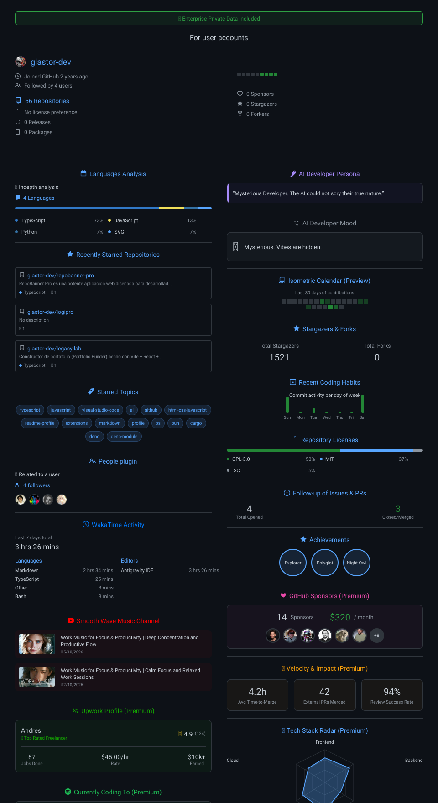
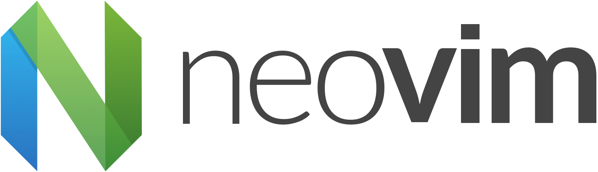

<!--
  ⚠️ SOURCE OF TRUTH: Edita este archivo, no el README.md generado.
  🔄 Última actualización: 2026-11-06
  📦 Versión del generador: v2.2.0
-->

# GLASTOR® — Ingeniería de Sistemas, Backend & Arquitectura Crítica

**Arquitecto Jefe en Rust & Python · Sistemas Distribuidos de Ultra-Baja Latencia · DevSecOps & Edge Tooling**

[](https://deno.land/)
[](https://hub.docker.com/)
[](https://github.com/evilmartians/lefthook)
[](https://github.com/glastor-dev/glastor-dev/actions/workflows/codeql.yml)
[](https://www.gnu.org/licenses/gpl-3.0)
[](https://creativecommons.org/licenses/by/4.0/)
[](https://hits.sh/github.com/glastor-dev/)
[](https://jsr.io/@glastor-dev/readmegen)
[](llms.txt)
[](https://jsr.io/@glastor-dev/readmegen)
[](https://status.glastor-dev.deno.net/glastor-dev/glastor-dev)

> [!NOTE]
> ⚡ **Autonomous Living Profile:** Este perfil es un artefacto de ingeniería vivo, autogenerado y validado en tiempo real con análisis AST de TypeScript, auditoría 4R (*Risk, Readability, Reliability, Resilience*) y despliegue continuo de su documentación técnica a [GitHub Pages (mdBook)](https://glastor-dev.github.io/glastor-dev/).

<div align="center">

**🟢 Disponible para proyectos — Próximas aperturas: Diciembre 2026**

[🏢 GLASTOR® Core](https://github.com/glastor-core) • [📖 Documentación Técnica (mdBook)](https://glastor-dev.github.io/glastor-dev/) • [📦 JSR Package](https://jsr.io/@glastor-dev/readmegen) • [💙 Sponsors](./SPONSORS.md) • [🔧 Toolbox](./TOOLBOX.md) • [📧 Contacto](mailto:ventas@glastor.es) • [🌐 Website](https://glastor.es)

</div>

> _"Andres entregó una solución de API que maneja **5,000 req/s con latencia p99 < 50ms**. Su trabajo redujo nuestros costos de infraestructura significativamente."_  
> — **Dan Khasis**, _Chief Executive Officer and Founder at [Route4Me](https://route4me.com/es)_

---

## 👋 Sobre mí

Arquitecto **sistemas distribuidos de misión crítica, backends de ultra-baja latencia y herramientas de automatización** en **Rust, Python y runtimes modernos (Deno 2 / Bun)** para empresas B2B en producción. Desde **2010 (+15 años de trayectoria y 150+ proyectos desplegados)**, transformo retos técnicos complejos en infraestructuras escalables de alto rendimiento, alto uptime y costos operativos optimizados.

**Fundador, CEO & Arquitecto Jefe en [GLASTOR®](https://glastor.es) y [GLASTOR® Core](https://github.com/glastor-core)** — Lidero la ingeniería directa —sin intermediarios— de motores de ejecución determinística, gateways Edge, análisis estático AST y pipelines DevSecOps que reducen latencias hasta un 90% y costos de infraestructura hasta un 40%.

🌍 **Operación Internacional Dual-Hub (España & Argentina):** Cobertura de husos horarios **CET (Europa)** y **ART / EST (Américas)**, con facturación corporativa internacional libre de impuestos locales (**Factura E de Exportación en USD/EUR**) y facturación local en Argentina (**Factura A / B — IVA Responsable Inscripto**).

### 💼 Especialidades técnicas

- ✅ **Sistemas Críticos en Rust & Python** — Microservicios seguros en memoria y APIs (FastAPI/Django) optimizadas para alto tráfico (5K+ req/s, p99 < 50ms)
- ✅ **Edge Runtimes & Developer Tooling** — Motores de alto rendimiento y baja latencia sobre Deno 2, Bun y TypeScript AST
- ✅ **DevSecOps & CI Predictivo** — Pipelines y orquestación inteligente que reducen tiempos de despliegue un 75% (30min → 7min)
- ✅ **Infraestructura Cloud & Contenedores** — Arquitecturas Docker, Kubernetes y AWS diseñadas para escalado horizontal y alta disponibilidad (HPC)

### 🔭 Actualmente trabajando en

- 🚀 **Ecosistema Deno 2 & JSR** — Generador de READMEs de alto rendimiento con análisis AST y plugins modulares (`@glastor-dev/readmegen`)
- 🏛️ **Plataforma [GLASTOR® Core](https://github.com/glastor-core)** — Sistemas distribuidos y motores Edge/CI: [`glastor-core`](https://github.com/glastor-core/glastor-core), [`nemesis`](https://github.com/glastor-core/nemesis) (DevSecOps), [`vortex`](https://github.com/glastor-core/vortex) (Predictive AST CI), [`zerho`](https://github.com/glastor-core/zerho) (Edge Docs), [`medusa`](https://github.com/glastor-core/medusa) (Edge API Gateway) y [`hyper-flow`](https://github.com/glastor-core/hyper-flow) (Edge AI API)
- 🤖 **Herramientas AI-Ready** — Integración nativa del estándar `llms.txt` y pipelines de automatización
- 🧪 **Smart injection engine** — Template engine inteligente que reduce boilerplate 60%
- 📝 **Contenido técnico** — Serie sobre arquitectura de APIs, optimización p99 y patrones backend
- 🤝 **Open Source** — Aceptando contribuciones en herramientas de developer experience (ver [CONTRIBUTING](.github/CONTRIBUTING.md))

### ✨ Disponible para

- **Arquitectura e Ingeniería B2B** en sistemas críticos, migraciones a Rust/Python y optimización de latencia/costos cloud
- **Code review & Auditoría DevSecOps** en infraestructuras Rust, Python/FastAPI y TypeScript (Deno/Bun)
- **Desarrollo** de motores core, tooling interno, CLI tools y automatizaciones determinísticas
- **Technical writing** y arquitectura de portales de documentación (`mdBook`, OpenAPI 3.1, `llms.txt`)
- **Proyectos Open Source** — Issues, RFCs y PRs bienvenidos en [GLASTOR® Core](https://github.com/glastor-core)

---

## 🛠️ Stack Tecnológico

<p align="center">
  <strong>Backend, Sistemas & Runtimes:</strong><br>
  <br><br>
  <strong>Frameworks, APIs & WebGL:</strong><br>
  <br><br>
  <strong>DevSecOps, Cloud & Edge Infra:</strong><br>
  <br><br>
  <strong>Databases, Caching & Developer Tooling:</strong><br>
  
</p>

### 🎓 Certificaciones & Aprendizaje

- 🏆 **AWS Solutions Architect** & **DevOps Specialist** (Arquitecturas cloud y microservicios)
- 📚 Especialización continua: Kubernetes (CKA), Advanced PostgreSQL Performance Tuning
- 🎯 Enfoque técnico: Rust (Tokio/Axum), FastAPI patterns, AsyncIO, Deno 2 / Bun Edge Runtimes, Distributed Systems & AI Agents

---

## 📊 GitHub Stats & Activity

<details>
  <summary><strong>📈 Ver métricas completas e historial de actividad</strong></summary>

<br>

<div align="center">



</div>

</details>

---

## 💙 Sponsors, Casos de Éxito & Ecosistema

<div align="center">

**Empresas con las que hemos desplegado sistemas críticos en producción y proyectos Open Source del ecosistema:**

<table>
  <tr>
    <td align="center" width="200">
      <a href="https://www.nexperia.com" target="_blank">
        <br>
        <strong>Nexperia</strong>
      </a><br>
      <sub>Automatización de pipeline de testing para semiconductores</sub>
    </td>
    <td align="center" width="200">
      <a href="https://aspidcars.com" target="_blank">
        <br>
        <strong>Aspid Cars</strong>
      </a><br>
      <sub>Sistema de gestión de inventario y logística</sub>
    </td>
    <td align="center" width="200">
      <a href="https://route4me.com/es" target="_blank">
        <br>
        <strong>Route4Me</strong>
      </a><br>
      <sub>API de geolocalización y routing en tiempo real</sub>
    </td>
  </tr>
  <tr>
    <td align="center" width="200">
      <a href="https://rizin.re/" target="_blank">
        <br>
        <strong>Rizin</strong>
      </a><br>
      <sub>Contribuciones al framework de ingeniería inversa</sub>
    </td>
    <td align="center" width="200">
      <a href="https://neovim.io/" target="_blank">
        <br>
        <strong>Neovim</strong>
      </a><br>
      <sub>Plugins y contribuciones al ecosistema</sub>
    </td>
    <td align="center" width="200">
      <strong>¿Tu empresa?</strong><br><br>
      <a href="./SPONSORS.md">
        
      </a><br>
      <sub>Apoya el ecosistema con Factura E / Factura A</sub>
    </td>
  </tr>
</table>

<br>

**Impacto comprobado:** +15 años en producción (desde 2010) • 150+ proyectos desplegados • Arquitecturas de 5K+ req/s (p99 < 50ms) • Hasta 40% ahorro en infraestructura

<br>

[](https://github.com/sponsors/glastor-dev)
[](./SPONSORS.md#-canales-de-pago--facturaci%C3%B3n-fiscal-factura-e--factura-a)
[](./SPONSORS.md#-canales-de-pago--facturaci%C3%B3n-fiscal-factura-e--factura-a)

<br>

👉 **[📄 Ver Programa Completo de Sponsorship, Tiers Corporativos y Facturación Fiscal (`SPONSORS.md`) →](./SPONSORS.md)**  
<sub>Emitimos <b>Factura E de Exportación de Servicios</b> (USD/EUR para empresas internacionales) y <b>Factura A / B</b> (IVA Responsable Inscripto en Argentina).</sub>

</div>

---

**🏆 Contributors Hall of Fame:**

Agradecemos a todos nuestros contributors:

<!-- ALL-CONTRIBUTORS-LIST:START -->
<!-- prettier-ignore-start -->
<!-- markdownlint-disable -->
<a href="https://github.com/glastor-dev/glastor-dev/graphs/contributors">
  
</a>
<!-- markdownlint-restore -->
<!-- prettier-ignore-end -->
<!-- ALL-CONTRIBUTORS-LIST:END -->

[Ver todos los contributors →](https://github.com/glastor-dev/glastor-dev/graphs/contributors)

---

## 📫 Contacto & Enlaces

<div align="center">

**💼 Disponible para proyectos freelance, consultoría técnica y colaboraciones**  
**📧 Tiempo de respuesta promedio: < 24 horas (normalmente < 6h)**  
**🗓️ [Agendar llamada de 30min](https://cal.com/glastor)** (gratis, sin compromiso)

<br>

<p align="center">
  <a href="https://t.me/zerhocool" title="Telegram - Respuesta más rápida">
    
  </a>
  &nbsp;&nbsp;&nbsp;
  <a href="mailto:glastor.info@gmail.com" title="Email - Consultas profesionales">
    
  </a>
  &nbsp;&nbsp;&nbsp;
  <a href="https://github.com/glastor-dev" title="GitHub - Código y proyectos">
    
  </a>
</p>

<br>

**🔗 Más recursos:**

[🌐 Website](https://glastor.es)

</div>

---

<details>
  <summary><strong>📖 Documentación Técnica & Arquitectura (Motor Autónomo)</strong></summary>

> 💡 **Portal Completo de Arquitectura:** Accede al manual técnico completo, diagramas de módulos y guías en el portal oficial: **[glastor-dev.github.io/glastor-dev](https://glastor-dev.github.io/glastor-dev/)**

### 📐 Architecture & Module Graph

```mermaid
graph TD
    src_generators_api_ts["src/generators/api.ts"]
    src_parsers_source_code_ts["src/parsers/source_code.ts"]
    src_generators_badges_ts["src/generators/badges.ts"]
    src_generators_doc_coverage_ts["src/generators/doc_coverage.ts"]
    src_generators_examples_ts["src/generators/examples.ts"]
    src_generators_llms_ts["src/generators/llms.ts"]
    src_parsers_deno_json_ts["src/parsers/deno_json.ts"]
    src_utils_user_config_ts["src/utils/user_config.ts"]
    src_generators_mermaid_ts["src/generators/mermaid.ts"]
    src_generators_toc_ts["src/generators/toc.ts"]
    src_main_ts["src/main.ts"]
    src_mod_ts["src/mod.ts"]
    src_utils_init_wizard_ts["src/utils/init_wizard.ts"]
    src_utils_logger_ts["src/utils/logger.ts"]
    src_project_analyze_ts["src/project/analyze.ts"]
    src_templates_load_ts["src/templates/load.ts"]
    src_templates_render_ts["src/templates/render.ts"]
    src_utils_file_system_ts["src/utils/file_system.ts"]
    src_parsers_imports_ts["src/parsers/imports.ts"]
    src_parsers_import_map_ts["src/parsers/import_map.ts"]
    src_parsers_project_files_ts["src/parsers/project_files.ts"]
    src_parsers_source_code_ast_ts["src/parsers/source_code_ast.ts"]
    src_parsers_workflows_ts["src/parsers/workflows.ts"]
    src_parsers_tests_ts["src/parsers/tests.ts"]
    src_utils_readme_infer_ts["src/utils/readme_infer.ts"]
    src_generators_api_ts --> src_parsers_source_code_ts
    src_generators_doc_coverage_ts --> src_parsers_source_code_ts
    src_generators_examples_ts --> src_parsers_source_code_ts
    src_generators_llms_ts --> src_parsers_deno_json_ts
    src_generators_llms_ts --> src_parsers_source_code_ts
    src_generators_llms_ts --> src_utils_user_config_ts
    src_main_ts --> src_mod_ts
    src_main_ts --> src_utils_init_wizard_ts
    src_main_ts --> src_utils_logger_ts
    src_mod_ts --> src_project_analyze_ts
    src_mod_ts --> src_templates_load_ts
    src_mod_ts --> src_templates_render_ts
    src_mod_ts --> src_utils_file_system_ts
    src_parsers_source_code_ast_ts --> src_parsers_source_code_ts
    src_parsers_source_code_ts --> src_parsers_source_code_ast_ts
    src_project_analyze_ts --> src_generators_api_ts
    src_project_analyze_ts --> src_generators_badges_ts
    src_project_analyze_ts --> src_generators_doc_coverage_ts
    src_project_analyze_ts --> src_generators_examples_ts
    src_project_analyze_ts --> src_generators_llms_ts
    src_project_analyze_ts --> src_generators_mermaid_ts
    src_project_analyze_ts --> src_generators_toc_ts
    src_project_analyze_ts --> src_parsers_deno_json_ts
    src_project_analyze_ts --> src_parsers_import_map_ts
    src_project_analyze_ts --> src_parsers_imports_ts
    src_project_analyze_ts --> src_parsers_project_files_ts
    src_project_analyze_ts --> src_parsers_source_code_ts
    src_project_analyze_ts --> src_parsers_tests_ts
    src_project_analyze_ts --> src_parsers_workflows_ts
    src_project_analyze_ts --> src_utils_readme_infer_ts
    src_project_analyze_ts --> src_utils_user_config_ts
    src_utils_init_wizard_ts --> src_utils_logger_ts
```



### 📚 API Reference (AST Autogenerated)

### scripts/code_review.ts
#### calculateReviewResult
- Type: function
- Signature: `calculateReviewResult(findings: Finding[], filesAnalyzed: string[]): ReviewResult`

#### Finding
- Type: interface

#### formatMarkdown
- Type: function
- Signature: `formatMarkdown(result: ReviewResult): string`

#### formatTerminal
- Type: function
- Signature: `formatTerminal(result: ReviewResult): string`

#### Pillar
- Type: type

#### PillarScore
- Type: interface

#### reviewFile
- Type: function
- Signature: `reviewFile(filePath: string, content: string): Finding[]`

#### ReviewResult
- Type: interface

#### Severity
- Type: type

### src/generators/api.ts
#### generateApiDocs
- Type: function
- Signature: `generateApiDocs(exports: ExportInfo[], projectRoot: string = Deno.cwd()): string`

### src/generators/badges.ts
#### BadgesConfig
- Type: interface

#### generateBadges
- Type: function
- Signature: `generateBadges(_config: BadgesConfig): string`

#### generateRepoBadges
- Type: function
- Signature: `generateRepoBadges(config: RepoBadgesConfig): string`

#### generateVisitorBadge
- Type: function
- Signature: `generateVisitorBadge(config: VisitorBadgeConfig): string`

#### RepoBadgesConfig
- Type: interface

#### VisitorBadgeConfig
- Type: interface

### src/generators/doc_coverage.ts
#### calculateDocCoverage
- Type: function
- Signature: `calculateDocCoverage(exports: ExportInfo[]): DocCoverageResult`

#### DocCoverageResult
- Type: interface

### src/generators/examples.ts
#### ExamplesOptions
- Type: interface

#### ExamplesResult
- Type: interface

#### generateExamples
- Type: function (async)
- Signature: `async generateExamples(projectRoot: string, exports: ExportInfo[], options: ExamplesOptions = {}): Promise<ExamplesResult>`

### src/generators/llms.ts
#### generateLlmsTxt
- Type: function (async)
- Signature: `async generateLlmsTxt(options: LlmsTxtOptions): Promise<string>`

#### LlmsTxtOptions
- Type: interface

### src/generators/mermaid.ts
#### generateMermaidGraph
- Type: function (async)
- Signature: `async generateMermaidGraph(projectRoot: string, options: MermaidGraphOptions = {}): Promise<string>`

#### MermaidGraphOptions
- Type: interface

### src/generators/toc.ts
#### generateToc
- Type: function
- Signature: `generateToc(options: TocOptions): string`

#### TocOptions
- Type: interface

### src/mod.ts
#### generateReadme
Generates the README documentation for the project by analyzing AST and rendering templates.
- Type: function (async)
- Signature: `async generateReadme(args: GenerateReadmeArgs): Promise<void>`
- Params:
  - args - Configuration options including template style, output file, and force flag.
- Returns - A promise that resolves when the README and related artifacts are generated.

```ts
await generateReadme({ template: "modern", output: "README.md", force: true });
```

#### GenerateReadmeArgs
Arguments for generating the project README
- Type: interface

#### sanitizeGeneratedMarkdown
Normalizes and cleans generated Markdown text by stripping BOM, removing accidental trash code,
and ensuring banner images are positioned at the document header.
- Type: function
- Signature: `sanitizeGeneratedMarkdown(markdown: string): string`
- Params:
  - markdown - Raw generated markdown content.
- Returns - Cleaned and sanitized markdown string.

#### TemplateName
Supported README template styles
- Type: type

### src/parsers/deno_json.ts
#### DenoConfig
- Type: interface

#### readDenoConfig
- Type: function (async)
- Signature: `async readDenoConfig(projectRoot: string): Promise<DenoConfig | null>`

### src/parsers/import_map.ts
#### ImportMap
- Type: interface

#### readImportMap
- Type: function (async)
- Signature: `async readImportMap(projectRoot: string): Promise<ImportMap | null>`

### src/parsers/imports.ts
#### analyzeImports
- Type: function (async)
- Signature: `async analyzeImports(projectRoot: string, options: AnalyzeImportsOptions = {}): Promise<ImportAnalysis>`

#### AnalyzeImportsOptions
- Type: interface

#### ImportAnalysis
- Type: interface

### src/parsers/project_files.ts
#### detectProjectFiles
- Type: function (async)
- Signature: `async detectProjectFiles(projectRoot: string): Promise<string[]>`

### src/parsers/source_code.ts
#### ExportInfo
- Type: interface

#### ExportType
- Type: type

#### extractExports
- Type: function (async)
- Signature: `async extractExports(filePath: string): Promise<ExportInfo[]>`

#### extractExportsFromProject
- Type: function (async)
- Signature: `async extractExportsFromProject(projectRoot: string, options: ExtractOptions = {}): Promise<ExportInfo[]>`

#### ExtractOptions
- Type: interface

#### JSDocParam
- Type: interface

### src/parsers/source_code_ast.ts
#### extractExportsAst
- Type: function (async)
- Signature: `async extractExportsAst(filePath: string): Promise<ExportInfo[]>`

#### extractExportsAstFromCode
- Type: function
- Signature: `extractExportsAstFromCode(code: string, filePath: string): ExportInfo[]`

#### JSDocInfo
- Type: interface

### src/parsers/workflows.ts
#### detectWorkflows
- Type: function (async)
- Signature: `async detectWorkflows(projectRoot: string): Promise<string[]>`

### src/project/analyze.ts
#### analyzeProject
- Type: function (async)
- Signature: `async analyzeProject(options: AnalyzeProjectOptions): Promise<ProjectAnalysis>`

#### AnalyzeProjectOptions
- Type: interface

#### ProjectAnalysis
- Type: interface

#### TemplateData
- Type: interface

### src/utils/file_system.ts
#### ensureWritableOutput
- Type: function (async)
- Signature: `async ensureWritableOutput(outputPath: string, options: { force: boolean }): Promise<void>`

### src/utils/init_wizard.ts
#### runInitWizard
- Type: function (async)
- Signature: `async runInitWizard(projectRoot: string)`

### src/utils/logger.ts
#### Logger
- Type: const
- Signature: `const Logger`

### src/utils/readme_infer.ts
#### inferDescriptionFromReadme
- Type: function (async)
- Signature: `async inferDescriptionFromReadme(readmePath: string): Promise<string | null>`

### src/utils/user_config.ts
#### loadUserConfig
- Type: function (async)
- Signature: `async loadUserConfig(projectRoot: string): Promise<UserConfig>`

#### UserConfig
- Type: interface

**Ver docs completas:** [API Documentation](https://glastor-dev.github.io/glastor-dev/)

</details>

<details>
  <summary><strong>📦 Dependencies & Tech Stack</strong></summary>

### Runtime & Installation

- **Deno** >= 2.1.0 (recommended: latest stable)
- **TypeScript** 5.x (bundled with Deno)

```bash
# Via Deno 2 (JSR)
deno install -g -A -n readmegen jsr:@glastor-dev/readmegen

# O ejecución directa sin instalación previa:
deno run -A jsr:@glastor-dev/readmegen
```

### Detected Project Dependencies & Manifests

### Config files
- deno.json/deno.jsonc
- import_map.json

### Project files
- Dockerfile
- LICENSE

### Standard Library
- jsr:@std/fs@^1.0.0/exists
- jsr:@std/fs@^1.0.0/walk
- jsr:@std/jsonc@^1.0.0/parse
- jsr:@std/path@^1.0.0/dirname
- jsr:@std/path@^1.0.0/extname
- jsr:@std/path@^1.0.0/glob-to-regexp
- jsr:@std/path@^1.0.0/join
- jsr:@std/path@^1.0.0/relative

### Third-party
- jsr:@cliffy/ansi@1.0.0-rc.7/colors
- jsr:@cliffy/command@1.0.0-rc.7
- jsr:@cliffy/prompt@1.0.0-rc.7
- npm:typescript@^5.7.0

</details>

---

<div align="center">

**📋 Políticas & Recursos del Proyecto**

[💙 Sponsors](SPONSORS.md) • [🔧 Toolbox & Setup](TOOLBOX.md) • [📞 Soporte](.github/SUPPORT.md) • [🔒 Seguridad](.github/SECURITY.md) • [⚖️ Código de Conducta](.github/CODE_OF_CONDUCT.md) • [📜 Licencia](LICENSE)

</div>

---

<div align="center">

© 2010-2026 GLASTOR-DEV — Todos los derechos reservados.

**2025 GLASTOR®** marca registrada en Argentina (INPI)  
Reg. 4559568 (Clase 42) y 4559567 (Clase 35) — Fecha: 19/08/2025

<br>

[](https://www.gnu.org/licenses/gpl-3.0.html)
&nbsp;&nbsp;
[](https://creativecommons.org/licenses/by/4.0/)

**Licencia Dual:**

- **Código de la herramienta:** Licenciado bajo [GNU GPL v3.0](https://www.gnu.org/licenses/gpl-3.0.html)
- **Textos generados y plantillas:** Licenciados bajo [Creative Commons Attribution 4.0 (CC BY 4.0)](https://creativecommons.org/licenses/by/4.0/)

---

<sub>🤖 README generado automáticamente • Versión 2.2.0 • Última actualización: 2026-11-06</sub>  
<sub>⭐ Si este proyecto te fue útil, considera darle una estrella en GitHub</sub>

</div>
