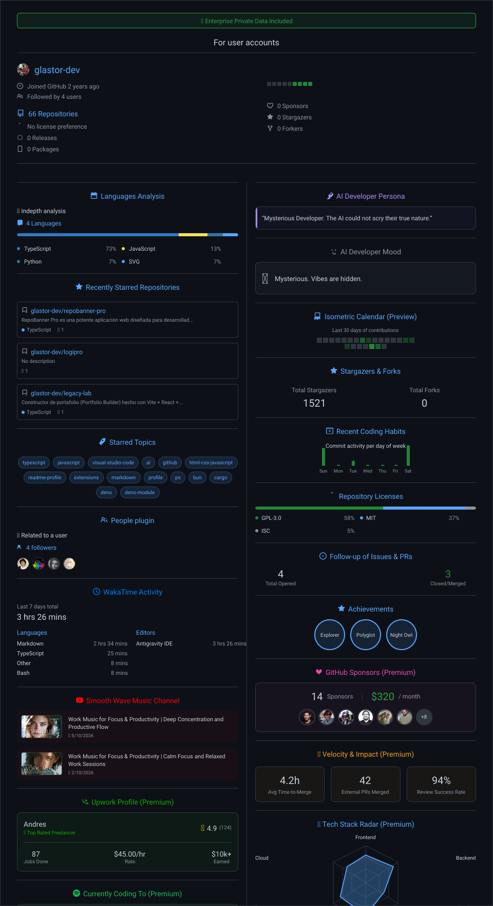
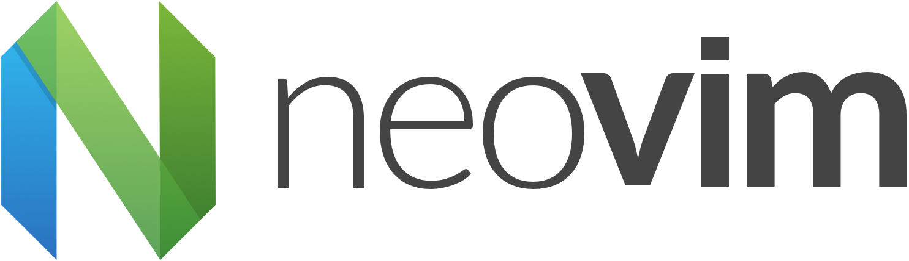

<!--
  ⚠️ SOURCE OF TRUTH: Edita este archivo, no el README.md generado.
  🔄 Última actualización: {{currentDate}}
  📦 Versión del generador: v{{currentVersion}}
-->

# GLASTOR® — Ingeniería de backend y arquitectura

**Ingeniero de backend en Python · Arquitecto de API · Automatización y DevOps**

[](https://deno.land/)
[](https://hub.docker.com/)
[](https://github.com/evilmartians/lefthook)
[](https://github.com/glastor-dev/glastor-dev/actions/workflows/codeql.yml)
[](https://www.gnu.org/licenses/gpl-3.0)
[](https://creativecommons.org/licenses/by/4.0/)
[](https://hits.sh/github.com/glastor-dev/)
[](https://jsr.io/@glastor-dev/readmegen)
[](llms.txt)
{{docCoverageBadge}}
[](https://status.glastor-dev.deno.net/glastor-dev/glastor-dev)

> [!NOTE]
> ⚡ **Autonomous Living Profile:** Este perfil es un artefacto de ingeniería vivo, autogenerado y validado en tiempo real con análisis AST de TypeScript, auditoría 4R (*Risk, Readability, Reliability, Resilience*) y despliegue continuo de su documentación técnica a [GitHub Pages (mdBook)](https://glastor-dev.github.io/glastor-dev/).

<div align="center">

**🟢 Disponible para proyectos — Próximas aperturas: {{nextOpening}}**

[🏢 GLASTOR® Core](https://github.com/glastor-core) • [📖 Documentación Técnica (mdBook)](https://glastor-dev.github.io/glastor-dev/) • [📦 JSR Package](https://jsr.io/@glastor-dev/readmegen) • [📧 Contacto](mailto:glastor.info@gmail.com) • [📁 Portfolio](./PORTFOLIO.md) • [🎥 Demo](https://youtube.com/@glastor-es)

</div>

---

## 👋 Sobre mí

Desarrollo **APIs REST de alto rendimiento** y **herramientas de automatización** con Python para equipos de producto en producción. Más de **15 años** creando soluciones backend escalables para empresas tecnológicas.

**Fundador y Lead Architect en [GLASTOR® Core](https://github.com/glastor-core)** — Especializado en arquitectura backend, DevOps, motores de análisis estático y soluciones técnicas que reducen costos operativos hasta un 40%.

> _"Andres entregó una solución de API que maneja 5,000 req/s con latencia p99 < 50ms. Su trabajo redujo nuestros costos de infraestructura significativamente."_  
> — **Dan Khasis**  
> _Chief Executive Officer and Founder, Route4Me_

### 💼 Especialidades técnicas

- ✅ **Backend Python** — APIs con FastAPI y Django, optimizadas para alto tráfico (5K+ req/s)
- ✅ **DevOps & CI/CD** — Pipelines robustos que reducen deployment time 75% (30min → 7min)
- ✅ **Contenedores** — Arquitecturas Docker que facilitan escalado horizontal automático
- ✅ **Git avanzado** — Flujos de trabajo con GitKraken, pair programming y code review efectivo

### 🔭 Actualmente trabajando en

- 🚀 **Ecosistema Deno 2 & JSR** — Generador de READMEs de alto rendimiento con análisis AST y plugins modulares (`@glastor-dev/readmegen`)
- 🤖 **Herramientas AI-Ready** — Integración nativa del estándar `llms.txt` y pipelines de automatización
- 🧪 **Smart injection engine** — Template engine inteligente que reduce boilerplate 60%
- 📝 **Contenido técnico** — Serie sobre arquitectura de APIs, optimización p99 y patrones backend
- 🤝 **Open Source** — Aceptando contribuciones en herramientas de developer experience (ver [CONTRIBUTING](.github/CONTRIBUTING.md))

### ✨ Disponible para

- **Consultoría técnica** en arquitectura de APIs y optimización de rendimiento
- **Code review** y auditoría de seguridad en proyectos Python/FastAPI
- **Desarrollo** de tooling interno, CLI tools y automatizaciones
- **Technical writing** y documentación de APIs
- **Proyectos Open Source** — Issues y PRs bienvenidos

---

## 🛠️ Stack Tecnológico

<p align="center">
  <strong>Backend & Lenguajes:</strong><br>
  <br><br>
  <strong>Frameworks & APIs:</strong><br>
  <br><br>
  <strong>DevOps & Cloud:</strong><br>
  <br><br>
  <strong>Databases & Tools:</strong><br>
  
</p>

### 🎓 Certificaciones & Aprendizaje

- 🏆 **AWS Solutions Architect** & **DevOps Specialist** (Arquitecturas cloud y microservicios)
- 📚 Especialización continua: Kubernetes (CKA), Advanced PostgreSQL Performance Tuning
- 🎯 Enfoque técnico: FastAPI patterns, AsyncIO, Distributed systems, AI Agents

---

## 📊 GitHub Stats & Activity

<details>
  <summary><strong>📈 Ver métricas completas e historial de actividad</strong></summary>

<br>

<div align="center">



</div>

</details>

---

## 💙 Sponsors & Colaboradores

<div align="center">

**Empresas que apoyan financieramente el desarrollo de herramientas Open Source:**

<table>
  <tr>
    <td align="center" width="200">
      <a href="https://www.nexperia.com" target="_blank">
        <br>
        <strong>Nexperia</strong>
      </a><br>
      <sub>Automatización de pipeline de testing para semiconductores</sub>
    </td>
    <td align="center" width="200">
      <a href="https://aspidcars.com" target="_blank">
        <br>
        <strong>Aspid Cars</strong>
      </a><br>
      <sub>Sistema de gestión de inventario y logística</sub>
    </td>
    <td align="center" width="200">
      <a href="https://rizin.re/" target="_blank">
        <br>
        <strong>Rizin</strong>
      </a><br>
      <sub>Contribuciones a reverse engineering framework</sub>
    </td>
  </tr>
  <tr>
    <td align="center" width="200">
      <a href="https://route4me.com/es" target="_blank">
        <br>
        <strong>Route4Me</strong>
      </a><br>
      <sub>API de geolocalización y routing en tiempo real</sub>
    </td>
    <td align="center" width="200">
      <a href="https://neovim.io/" target="_blank">
        <br>
        <strong>Neovim</strong>
      </a><br>
      <sub>Plugins y contribuciones al ecosistema</sub>
    </td>
    <td align="center" width="200">
      <strong>¿Tu empresa?</strong><br><br>
      <a href="#-convertirte-en-sponsor">
        
      </a><br>
      <sub>Apoya el desarrollo Open Source</sub>
    </td>
  </tr>
</table>

<br>

**Impacto comprobado:** +15 años en producción • Arquitecturas de 5K+ req/s (p99 < 50ms) • Hasta 40% ahorro en infraestructura

</div>

---

### 🤝 Convertirte en Sponsor

Tu apoyo permite dedicar más tiempo al desarrollo de herramientas Open Source de calidad profesional.

<div align="center">

[](https://github.com/sponsors/glastor-dev)


<br>

<details>
<summary><b>📄 Coordenadas para transferencia bancaria directa (USD / ARS)</b></summary>
<br>

Para transferencias directas ACH (USD), wire internacional o transferencias locales (ARS / Galicia):  
👉 [**Solicitar datos bancarios vía email**](mailto:glastor.info@gmail.com?subject=Solicitud%20de%20datos%20bancarios%20para%20Sponsorship)

_Se proporcionan de forma privada para mayor seguridad y emisión de la factura/recibo correspondiente._

</details>

</div>

**Beneficios según tier:**

| Tier              | Inversión/mes | Beneficios                                                       |
| ----------------- | ------------- | ---------------------------------------------------------------- |
| 🥉 **Bronze**     | 10 USD        | Logo en README • Mención en releases                             |
| 🥈 **Silver**     | 50 USD        | Todo anterior + Prioridad en issues • Acceso temprano a features |
| 🥇 **Gold**       | 100 USD       | Todo anterior + 2h consultoría/mes • Code review prioritario     |
| 💎 **Platinum**   | 500 USD       | Todo anterior + Feature requests dedicados • Soporte 24/7        |
| 🏢 **Enterprise** | Custom        | Soluciones a medida • SLA garantizado • Desarrollo privado       |

**ROI para empresas:**

- 🎯 Visibilidad ante 50K+ developers activos
- 🔧 Acceso prioritario a herramientas que aumentan productividad
- 🤝 Relación directa con maintainer experimentado
- 📈 Soporte para herramientas críticas en tu stack

[📧 Contactar para plan Enterprise](mailto:glastor.info@gmail.com?subject=Enterprise%20Sponsorship)

---

**🏆 Contributors Hall of Fame:**

Agradecemos a todos nuestros contributors:

<!-- ALL-CONTRIBUTORS-LIST:START -->
<!-- prettier-ignore-start -->
<!-- markdownlint-disable -->
<a href="https://github.com/glastor-dev/glastor-dev/graphs/contributors">
  
</a>
<!-- markdownlint-restore -->
<!-- prettier-ignore-end -->
<!-- ALL-CONTRIBUTORS-LIST:END -->

[Ver todos los contributors →](https://github.com/glastor-dev/glastor-dev/graphs/contributors)

---

## 📫 Contacto & Enlaces

<div align="center">

**💼 Disponible para proyectos freelance, consultoría técnica y colaboraciones**  
**📧 Tiempo de respuesta promedio: < 24 horas (normalmente < 6h)**  
**🗓️ [Agendar llamada de 30min](https://cal.com/glastor)** (gratis, sin compromiso)

<br>

<p align="center">
  <a href="https://t.me/zerhocool" title="Telegram - Respuesta más rápida">
    
  </a>
  &nbsp;&nbsp;&nbsp;
  <a href="mailto:glastor.info@gmail.com" title="Email - Consultas profesionales">
    
  </a>
  &nbsp;&nbsp;&nbsp;
  <a href="https://github.com/glastor-dev" title="GitHub - Código y proyectos">
    
  </a>
</p>

<br>

**🔗 Más recursos:**

[🌐 Website](https://glastor.es)

</div>

---

<details>
  <summary><strong>📖 Documentación Técnica & Arquitectura (Motor Autónomo)</strong></summary>

> 💡 **Portal Completo de Arquitectura:** Accede al manual técnico completo, diagramas de módulos y guías en el portal oficial: **[glastor-dev.github.io/glastor-dev](https://glastor-dev.github.io/glastor-dev/)**

### API Reference

#### Core Generators & Review Tools

```typescript
generateReadme(args: GenerateReadmeArgs): Promise<string>
// Generador principal de README con análisis completo de proyecto

generateMermaidGraph(projectRoot: string): Promise<string>
// Grafo de módulos y dependencias de arquitectura en formato Mermaid

generateLlmsTxt(analysis: ProjectAnalysis): string
// Generador del estándar llms.txt para agentes y LLMs

calculateDocCoverage(exports: ExportInfo[]): DocCoverageResult
// Auditoría de cobertura de documentación JSDoc y badges

reviewFile(filePath: string, content: string): FileReview
// Auditoría de código bajo 4Rs: Risk, Readability, Reliability, Resilience

generateBadges(_config: BadgesConfig): string
// Genera badges dinámicos basados en project config

generateApiDocs(exports: ExportInfo[]): string
// Documenta exports automáticamente desde análisis AST

generateToc(options: TocOptions): string
// Tabla de contenidos con links automáticos
```

#### Project Analysis

```typescript
analyzeProject(options: AnalyzeProjectOptions): Promise<ProjectAnalysis>
// Análisis completo: estructura, deps, tests, workflows

extractExports(filePath: string): Promise<ExportInfo[]>
// Extrae exports de archivos TS/JS con tipos y JSDoc

detectTests(projectRoot: string): Promise<TestDetection>
// Detecta frameworks de testing y coverage

readDenoConfig(projectRoot: string): Promise<DenoConfig>
// Lee y parsea deno.json/deno.jsonc
```

#### Utilities

```typescript
sanitizeGeneratedMarkdown(markdown: string): string
// Limpia y normaliza markdown generado

loadUserConfig(projectRoot: string): Promise<UserConfig>
// Carga configuración de usuario desde .readmegen.json

ensureWritableOutput(path: string, options: WriteOptions): Promise<void>
// Valida permisos y crea directorio si necesario
```

**Ver docs completas:** [API Documentation](https://glastor-dev.github.io/glastor-dev/)

</details>

<details>
  <summary><strong>📦 Dependencies & Tech Stack</strong></summary>

### Runtime Requirements

- **Deno** >= 2.1.0 (recommended: latest stable)
- **TypeScript** 5.x (bundled with Deno)
- **Node.js** 18+ (optional, for npm packages)

### Core Dependencies (JSR)

**Standard Library:**

```json
{
  "@std/assert": "^1.0.0", // Testing assertions
  "@std/fs": "^1.0.0", // File system operations
  "@std/path": "^1.0.0", // Path manipulation
  "@std/jsonc": "^1.0.0" // JSON with comments parser
}
```

**CLI Framework:**

```json
{
  "@cliffy/command": "1.0.0-rc.7", // Command-line framework
  "@cliffy/prompt": "1.0.0-rc.7", // Interactive prompts
  "@cliffy/ansi": "1.0.0-rc.7" // Terminal colors & formatting
}
```

### Third-party (npm)

```json
{
  "typescript": "^5.7.0" // TypeScript Compiler AST API (offline, zero WASM)
}
```

### Optional Integrations

- **Pandoc** — Para export a PDF/DOCX
- **Playwright** — Para screenshots automáticos
- **Sharp** — Image optimization

**Installation & Usage:**

```bash
# Via Deno 2 (JSR)
deno install -g -A -n readmegen jsr:@glastor-dev/readmegen

# O ejecución directa sin instalación previa:
deno run -A jsr:@glastor-dev/readmegen
```

</details>

<details>
  <summary><strong>🔧 Development Setup & Toolbox</strong></summary>

### 🖥️ Entorno de Desarrollo

**Sistemas Operativos:**

- 🐧 **Arch Linux** (principal) — Kernel 6.x custom
  - Terminal: Xterm + Zsh + Oh-My-Zsh
  - WM: i3-gaps con Polybar
  - Terminal alternativo: eDEX-UI (cyberpunk style)
- 🪟 **Windows 10 Pro** (testing)
  - Terminal: Windows Terminal + Git Bash
  - WSL2: Ubuntu 22.04 LTS

**Editores & IDEs:**

- 💻 **VS Code** (principal) — Extensions:
  - Python, Deno, ESLint, Prettier
  - GitLens, Docker, Thunder Client
  - Quimera Theme (propio)
- ⚡ **Neovim** — Para edición rápida y remota
  - Config: LazyVim + custom plugins
  - LSP: pyright, tsserver, rust-analyzer

**Version Control:**

- 🦑 **GitKraken PRO** — GUI para operaciones complejas
- 🔧 **Git CLI** — Para automation y scripts
- 📊 **GitHub Desktop** — Para quick commits

### 🎯 Áreas de Especialización

**Backend & APIs:**

- FastAPI patterns & best practices
- Django REST Framework optimization
- GraphQL con Strawberry/Ariadne
- gRPC con Python

**DevOps & Infrastructure:**

- Docker multi-stage builds
- Docker Compose orchestration
- GitHub Actions workflows
- AWS (EC2, Lambda, RDS, S3)
- Terraform (IaC)

**Security & Cryptography:**

- OWASP Top 10 mitigation
- JWT/OAuth2 implementation
- Encryption (AES, RSA)
- Penetration testing basics
- Secure coding practices

**AI/ML & Automation:**

- Prompt Engineering (GPT-4, Claude)
- LangChain for AI workflows
- OpenAI API integration
- Automation scripts (Python, Bash)
- Web scraping (Beautiful Soup, Scrapy)

**Documentation & Technical Writing:**

- API documentation (OpenAPI/Swagger)
- Technical blog writing
- Video tutorial creation
- Code documentation standards

### 📚 Lecturas & Formación Continua

**Libros técnicos recientes:**

- ✅ _The Pragmatic Programmer_ (20th Anniversary)
- ✅ _Clean Architecture_ — Robert C. Martin
- ✅ _Designing Data-Intensive Applications_ — Martin Kleppmann
- 📖 _Building Microservices_ (2nd ed.) — En progreso
- 📖 _Site Reliability Engineering_ — Google (En progreso)

**Cursos & Certificaciones en proceso:**

- 🎓 AWS Solutions Architect Associate (Completado)
- 🎓 Certified Kubernetes Administrator (CKA) (En preparación)
- 📚 FastAPI Advanced Patterns & AI Agent Architectures

**Podcasts favoritos:**

- 🎙️ Talk Python To Me
- 🎙️ Python Bytes
- 🎙️ The Changelog
- 🎙️ Software Engineering Daily

</details>

---

<div align="center">

**📋 Políticas del Proyecto**

[📞 Soporte](.github/SUPPORT.md) • [🔒 Seguridad](.github/SECURITY.md) • [⚖️ Código de Conducta](.github/CODE_OF_CONDUCT.md) • [📜 Licencia](LICENSE)

</div>

---

<div align="center">

© 2010-{{currentYear}} GLASTOR-DEV — Todos los derechos reservados.

**2025 GLASTOR®** marca registrada en Argentina (INPI)  
Reg. 4559568 (Clase 42) y 4559567 (Clase 35) — Fecha: 19/08/2025

<br>

[](https://www.gnu.org/licenses/gpl-3.0.html)
&nbsp;&nbsp;
[](https://creativecommons.org/licenses/by/4.0/)

**Licencia Dual:**

- **Código de la herramienta:** Licenciado bajo [GNU GPL v3.0](https://www.gnu.org/licenses/gpl-3.0.html)
- **Textos generados y plantillas:** Licenciados bajo [Creative Commons Attribution 4.0 (CC BY 4.0)](https://creativecommons.org/licenses/by/4.0/)

---

<sub>🤖 README generado automáticamente • Versión {{currentVersion}} • Última actualización: {{currentDate}}</sub>  
<sub>⭐ Si este proyecto te fue útil, considera darle una estrella en GitHub</sub>

</div>
