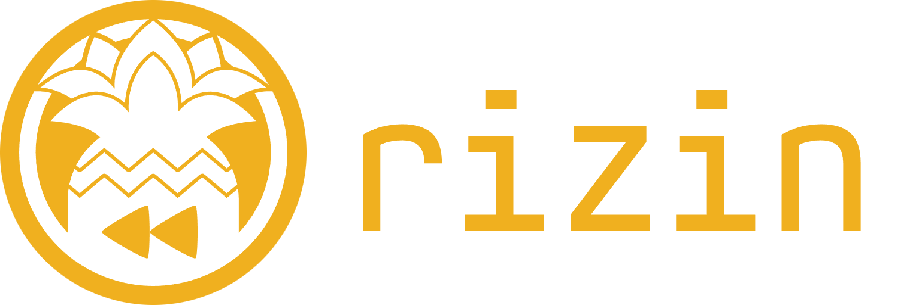
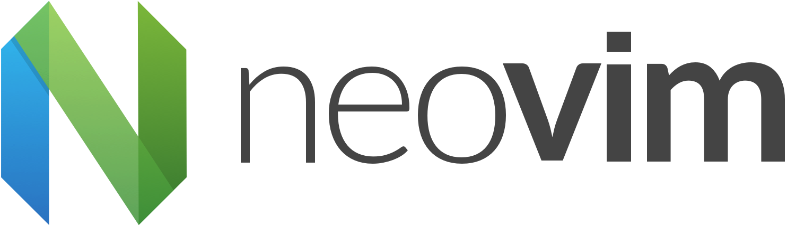

# 💙 GLASTOR® — Programa de Sponsorship & Alianzas B2B

**Impulsando la ingeniería Open Source de alto rendimiento, sistemas distribuidos en Rust & Python y tooling de próxima generación en Deno 2 / Bun.**

[👤 Perfil Personal (`@glastor-dev`)](https://github.com/glastor-dev) • [🏢 Organización (`glastor-core`)](https://github.com/glastor-core) • [📖 Documentación Técnica (mdBook)](https://glastor-dev.github.io/glastor-dev/) • [🌐 Sitio Oficial (`glastor.es`)](https://glastor.es)

---

## 🎯 ¿Qué financia tu patrocinio?

El programa de Sponsorship de **GLASTOR®** sostiene el desarrollo continuo, las auditorías de seguridad y el mantenimiento libre de dependencias comerciales del **Ecosistema Dual-Core** ([`glastor-dev`](https://github.com/glastor-dev) + [`glastor-core`](https://github.com/glastor-core)):

| Proyecto / Motor                                                      | Ámbito                           | Impacto Técnico                                                                                                              |
| :-------------------------------------------------------------------- | :------------------------------- | :--------------------------------------------------------------------------------------------------------------------------- |
| **[`@glastor-dev/readmegen`](https://jsr.io/@glastor-dev/readmegen)** | Developer Tooling (JSR / Deno 2) | Generador autónomo de documentación mediante análisis AST de TypeScript, auditoría 4R y soporte nativo `llms.txt`.           |
| **[`glastor-core`](https://github.com/glastor-core/glastor-core)**    | Distributed Systems Kernel       | Primitivas de ejecución determinística y pipelines stateful de sub-milisegundo para microservicios críticos.                 |
| **[`nemesis`](https://github.com/glastor-core/nemesis)**              | DevSecOps & Compliance           | Motor CLI y GitHub Action para auditoría de seguridad continua, higiene de repositorios y auto-fix.                          |
| **[`vortex`](https://github.com/glastor-core/vortex)**                | Predictive CI & FinOps           | Orquestador de CI basado en AST, podador de barrels y divisor dinámico de tests (LPT) para reducir costos en GitHub Actions. |
| **[`zerho`](https://github.com/glastor-core/zerho)**                  | Edge Documentation Engine        | Motor de documentación de ultra-alta velocidad para Deno 2 & Edge con explorador OpenAPI interactivo y `llms.txt`.           |
| **[`medusa`](https://github.com/glastor-core/medusa)**                | Edge API Gateway                 | Proxy resiliente con Circuit Breaker, deduplicación Single-Flight y caché distribuida en Deno KV.                            |
| **[`hyper-flow`](https://github.com/glastor-core/hyper-flow)**        | Edge AI Runtime                  | API de IA en el Edge de ultra-alto rendimiento construida con Hono, Bun y OpenAPI 3.1.                                       |

---

## 🏆 Empresas, Casos en Producción & Ecosistema Open Source

**Organizaciones con las que hemos construido sistemas críticos en producción y proyectos del ecosistema Open Source con los que colaboramos:**

<table>
  <tr>
    <td align="center" width="220">
      <a href="https://www.nexperia.com" target="_blank">
         
        <strong>Nexperia</strong>
      </a> 
      Automatización de pipeline de testing para semiconductores
    </td>
    <td align="center" width="220">
      <a href="https://aspidcars.com" target="_blank">
         
        <strong>Aspid Cars</strong>
      </a> 
      Sistema de gestión de inventario y logística de alto rendimiento
    </td>
    <td align="center" width="220">
      <a href="https://route4me.com/es" target="_blank">
         
        <strong>Route4Me</strong>
      </a> 
      API de geolocalización y routing en tiempo real (5K+ req/s, p99 &lt; 50ms)
    </td>
  </tr>
  <tr>
    <td align="center" width="220">
      <a href="https://rizin.re/" target="_blank">
         
        <strong>Rizin</strong>
      </a> 
      Contribuciones al framework Open Source de ingeniería inversa
    </td>
    <td align="center" width="220">
      <a href="https://neovim.io/" target="_blank">
         
        <strong>Neovim</strong>
      </a> 
      Plugins y contribuciones al ecosistema de edición de alta velocidad
    </td>
    <td align="center" width="220">
      <strong>¿Tu empresa?</strong>  
       
      Impulsa el ecosistema Open Source con factura fiscal deducible
    </td>
  </tr>
</table>

 

**Métricas de impacto comprobado:** +15 años en producción (desde 2010) • 150+ proyectos desplegados • Arquitecturas de 5K+ req/s (p99 < 50ms) • Hasta 40% de ahorro en infraestructura cloud

---

## 💎 Tiers de Sponsorship & Beneficios B2B

Cada nivel está diseñado para generar **retorno técnico directo (ROI)** para desarrolladores individuales, startups y equipos corporativos de ingeniería:

| Tier              | Inversión / mes | Beneficios Técnicos y Corporativos                                                                                                                                                                                           | Facturación Disponible                          |
| :---------------- | :-------------- | :--------------------------------------------------------------------------------------------------------------------------------------------------------------------------------------------------------------------------- | :---------------------------------------------- |
| 🥉 **Bronze**     | **10 USD**      | • Insignia y mención en `README.md` y `SPONSORS.md` • Agradecimiento en notas de versión (_Release Notes_)                                                                                                                | GitHub Sponsors / Recibo                        |
| 🥈 **Silver**     | **50 USD**      | • Todo lo incluido en **Bronze** • Prioridad en el triaje de _Issues_ en `glastor-dev` y `glastor-core` • Acceso temprano a nuevas reglas AST y módulos                                                                | GitHub Sponsors / Factura A, B o E              |
| 🥇 **Gold**       | **100 USD**     | • Todo lo incluido en **Silver** • **2 horas/mes de consultoría técnica o Code Review** (Rust, Python/FastAPI, Deno/Bun) • Auditoría automatizada de tus repositorios con `nemesis` y `vortex`                         | Factura E (Exportación) / Factura A (Argentina) |
| 💎 **Platinum**   | **500 USD**     | • Todo lo incluido en **Gold** • Logo destacado en `glastor-dev`, `glastor-core` y portal mdBook • **Feature requests priorizados** en el Roadmap trimestral • Canal directo de soporte técnico prioritario (< 12h) | Factura E (Exportación) / Factura A (Argentina) |
| 🏢 **Enterprise** | **Custom**      | • **Ingeniería B2B a medida** en Rust, Python y Edge Runtimes • SLA garantizado por contrato y despliegues privados • Optimización de latencia p99 y reducción de costos cloud/CI                                      | Contrato B2B + Factura E / Factura A            |

### 📈 ROI para Empresas Patrocinadoras

- **🎯 Posicionamiento de Marca Técnica:** Visibilidad ante +50K desarrolladores, arquitectos de sistemas y líderes técnicos que utilizan nuestras herramientas y documentación.
- **🔧 Influencia Directa en el Roadmap:** Priorización de funcionalidades, parsers AST, reglas de seguridad (`nemesis`) o integraciones CI (`vortex`) que tu equipo necesite en producción.
- **🛡️ Reducción de Costos Operativos:** Acceso directo a arquitectos senior (+15 años de trayectoria) sin intermediarios comerciales.
- **🧾 Deducción Fiscal Completa (100% B2B):** Al operar como **Responsable Inscripto en Argentina**, emitimos **Factura E de Exportación de Servicios** para empresas del exterior (EE. UU., Unión Europea, LATAM) y **Factura A** con IVA discriminado para empresas radicadas en Argentina.

---

## 💳 Canales de Pago & Facturación Fiscal (Factura E / Factura A)

Ofrecemos canales de pago adaptados tanto para patrocinios ágiles vía tarjeta como para circuitos administrativos de compras corporativas (_Procurement / Accounts Payable_):

### 1. GitHub Sponsors (Tarjeta / PayPal — Automático)

Ideal para suscripciones mensuales rápidas de desarrolladores y equipos:
👉 **[Patrocinar en GitHub Sponsors (`github.com/sponsors/glastor-dev`)](https://github.com/sponsors/glastor-dev)**

---

### 2. Empresas Internacionales — Transferencia ACH (USD) / Wire Internacional + **Factura E**

Para empresas radicadas en **Estados Unidos, Europa (UE) o resto del mundo** que requieren factura comercial de exportación deducible de impuestos:

- **Condición Fiscal:** Exportación de Servicios de Ingeniería y Software desde Argentina.
- **Comprobante Oficial:** Emisión de **Factura E electrónica oficial (ARCA / ex-AFIP)** en **USD** o **EUR**, libre de IVA local y válida para contabilidad internacional.
- **Medios de Recepción:** Transferencia local en EE. UU. vía **ACH (USD)** (Takenos / cuenta receptora en EE. UU.) o transferencia internacional **SWIFT / Wire**.

📩 **[Solicitar coordenadas ACH / Wire y alta de proveedor (Factura E)](mailto:ventas@glastor.es?cc=glastor.info@gmail.com&subject=Sponsorship%20B2B%20Internacional%20-%20Solicitud%20de%20Factura%20E%20y%20Datos%20ACH)**

---

### 3. Empresas en Argentina — Transferencia Bancaria Local (ARS / USD) + **Factura A / B**

Para empresas, pymes y profesionales radicados en la **República Argentina**:

- **Condición Fiscal:** **IVA Responsable Inscripto** en Argentina.
- **Comprobante Oficial:** Emisión de **Factura A** (con IVA discriminado para Responsables Inscriptos) o **Factura B**.
- **Medios de Recepción:** Transferencia bancaria directa vía **Banco Galicia** (CBU / Alias en **ARS** o **USD**).

📩 **[Solicitar CBU / Alias de Banco Galicia y emisión de Factura A](mailto:glastor.info@gmail.com?cc=ventas@glastor.es&subject=Sponsorship%20Argentina%20-%20Solicitud%20de%20Datos%20Banco%20Galicia%20y%20Factura%20A)**

> 🔒 _Por razones de seguridad bancaria y cumplimiento de políticas anti-fraude, los números de cuenta, routing ACH y CBU se envían de forma privada tras el contacto por correo electrónico junto con la factura correspondiente._

---

## 📫 Contacto Directo para Alianzas & Plan Enterprise

- **📧 Email Corporativo & Ventas B2B:** [ventas@glastor.es](mailto:ventas@glastor.es)
- **📧 Email Directo & Administración (Argentina):** [glastor.info@gmail.com](mailto:glastor.info@gmail.com)
- **🗓️ Reunión de Alineación (30 min sin cargo):** [cal.com/glastor](https://cal.com/glastor)
- **💬 Telegram Directo:** [@zerhocool](https://t.me/zerhocool)

---

[⬅️ Volver al Perfil Principal (`README.md`)](./README.md) • [🏢 Ir a `glastor-core`](https://github.com/glastor-core) • [🌐 Visitar `glastor.es`](https://glastor.es)

© 2010–2026 GLASTOR® — Marca registrada en Argentina (INPI Reg. 4559568 y 4559567). Todos los derechos reservados.

