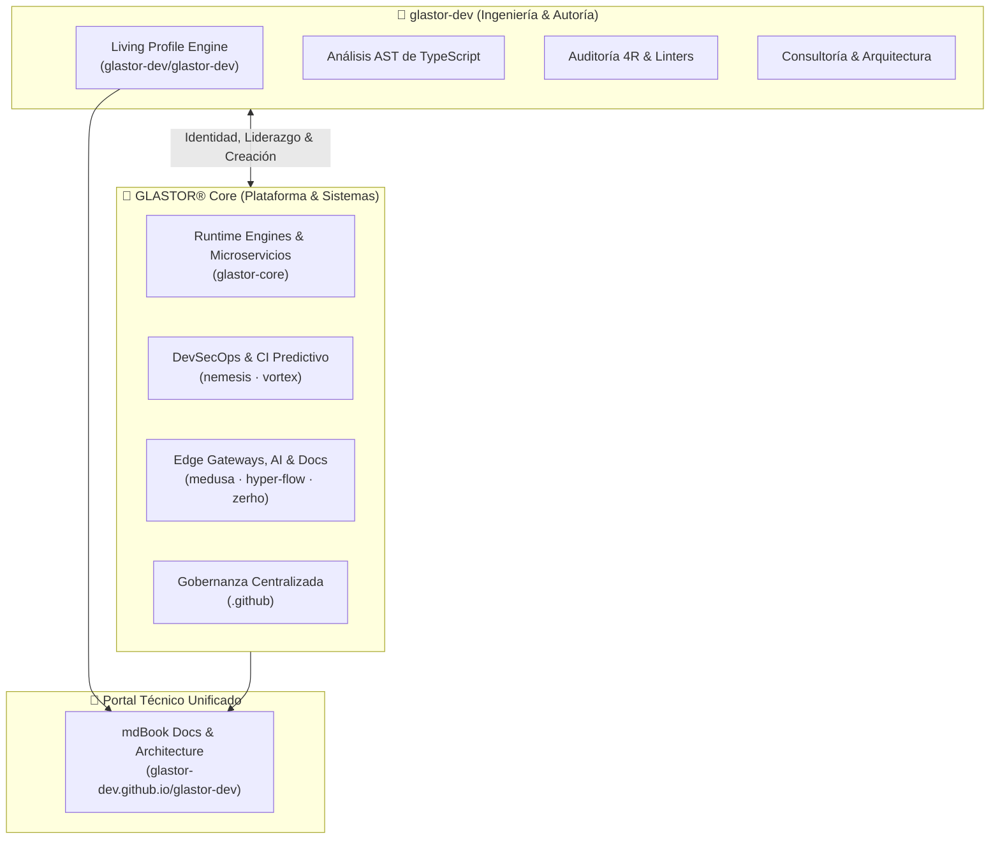

# 🌐 Ecosistema GLASTOR®: Personal & Organización

El **Ecosistema GLASTOR®** implementa el patrón de arquitectura abierta **Dual-Core**, estableciendo una sinergia bidireccional entre la identidad técnica del desarrollador y la organización institucional.

---

## 🏛️ El Modelo Dual-Core

En el desarrollo open-source y la ingeniería de software de alto impacto, separar y a la vez conectar la **autoría personal** y la **plataforma institucional** garantiza claridad de propósito, escalabilidad y máxima transparencia técnica:

---

## 🧭 Pilares del Ecosistema

### 1. Perfil Personal: [github.com/glastor-dev](https://github.com/glastor-dev)

- **Rol:** Representa a **Andres A. Cardoso**, Fundador, CEO & Arquitecto Jefe de **GLASTOR®** ([glastor.es](https://glastor.es)).
- **Living Profile (`glastor-dev/glastor-dev`):** Demuestra en tiempo real la confiabilidad del código mediante _dogfooding_: el perfil no es un documento estático, sino un artefacto de ingeniería compilado periódicamente por pipelines de CI/CD, extrayendo tipos mediante AST e inyectando métricas.
- **Especialidades:** Sistemas distribuidos y microservicios críticos en **Rust y Python** (FastAPI/Django), runtimes de alta velocidad (**Deno 2 / Bun**), ingeniería de automatización, DevSecOps y optimización de latencia/costos B2B.

### 2. Organización: [github.com/glastor-core](https://github.com/glastor-core)

- **Rol:** La entidad colectiva y el hogar de las herramientas críticas de infraestructura.
- **Misión:** Desarrollar motores de ejecución determinística, arquitecturas resilientes para edge/cloud y plataformas de developer experience de última generación.
- **Repositorios Core:**
  - **[`glastor-core`](https://github.com/glastor-core/glastor-core)**: Primitivas, kernel modular y runtime principal para microservicios y pipelines stateful de baja latencia.
  - **[`nemesis`](https://github.com/glastor-core/nemesis)**: Framework, CLI y GitHub Action de auditoría continua DevSecOps, higiene de repositorios y auto-fix.
  - **[`vortex`](https://github.com/glastor-core/vortex)**: Orquestador de CI predictivo basado en AST, podador de barrels, divisor dinámico de tests (LPT) y motor FinOps para GitHub Actions.
  - **[`zerho`](https://github.com/glastor-core/zerho)**: Motor de documentación de alto rendimiento para Deno 2 y Edge runtimes con playground interactivo, explorador OpenAPI y soporte nativo `llms.txt`.
  - **[`medusa`](https://github.com/glastor-core/medusa)**: Edge API Gateway resiliente y proxy de caché con Circuit Breaker, deduplicación Single-Flight y Deno KV.
  - **[`hyper-flow`](https://github.com/glastor-core/hyper-flow)**: API de IA en el Edge de ultra-alto rendimiento construida con Hono, Bun y OpenAPI 3.1.
  - **[`.github`](https://github.com/glastor-core/.github)**: Gobernanza centralizada, políticas de seguridad, RFCs y workflows reutilizables de CI/CD.

### 3. Portal de Documentación: [glastor-dev.github.io/glastor-dev](https://glastor-dev.github.io/glastor-dev/)

- **Rol:** El centro de conocimiento unificado (Technical Knowledge Base) compilado con **mdBook**.
- **Contenido:** Guías paso a paso, análisis profundo de arquitectura, referencia exhaustiva de APIs y estándares de calidad para todo el ecosistema.

---

## 🔗 Enlaces y Recursos Oficiales

- **Organización en GitHub:** [https://github.com/glastor-core](https://github.com/glastor-core)
- **Perfil del Creador:** [https://github.com/glastor-dev](https://github.com/glastor-dev)
- **Paquete CLI en JSR:** [@glastor-dev/readmegen](https://jsr.io/@glastor-dev/readmegen)
- **Sitio Web Oficial:** [https://glastor.es](https://glastor.es)
