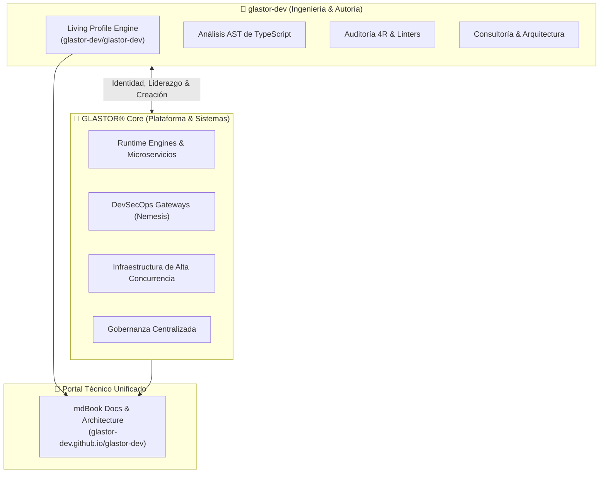

# 🌐 Ecosistema GLASTOR®: Personal & Organización

El **Ecosistema GLASTOR®** implementa el patrón de arquitectura abierta **Dual-Core**, estableciendo una sinergia bidireccional entre la identidad técnica del desarrollador y la organización institucional.

---

## 🏛️ El Modelo Dual-Core

En el desarrollo open-source y la ingeniería de software de alto impacto, separar y a la vez conectar la **autoría personal** y la **plataforma institucional** garantiza claridad de propósito, escalabilidad y máxima transparencia técnica:

---

## 🧭 Pilares del Ecosistema

### 1. Perfil Personal: [github.com/glastor-dev](https://github.com/glastor-dev)
- **Rol:** Representa al creador, arquitecto de software y consultor senior (Andres).
- **Living Profile (`glastor-dev/glastor-dev`):** Demuestra en tiempo real la confiabilidad del código mediante *dogfooding*: el perfil no es un documento estático, sino un artefacto de ingeniería compilado periódicamente por pipelines de CI/CD, extrayendo tipos mediante AST e inyectando métricas.
- **Especialidades:** APIs de alto rendimiento con Python (FastAPI/Django), ingeniería de automatización, DevOps y testing estricto.

### 2. Organización: [github.com/glastor-core](https://github.com/glastor-core)
- **Rol:** La entidad colectiva y el hogar de las herramientas críticas de infraestructura.
- **Misión:** Desarrollar motores de ejecución determinística, arquitecturas resilientes para edge/cloud y plataformas de developer experience de última generación.
- **Repositorios Core:**
  - **`glastor-core`**: Primitivas y runtime principal para microservicios y streaming con baja latencia.
  - **`nemesis`**: Framework y gateway de auditoría continua DevSecOps.
  - **`.github`**: Gobernanza centralizada y plantillas institucionales de seguridad y colaboración.

### 3. Portal de Documentación: [glastor-dev.github.io/glastor-dev](https://glastor-dev.github.io/glastor-dev/)
- **Rol:** El centro de conocimiento unificado (Technical Knowledge Base) compilado con **mdBook**.
- **Contenido:** Guías paso a paso, análisis profundo de arquitectura, referencia exhaustiva de APIs y estándares de calidad para todo el ecosistema.

---

## 🔗 Enlaces y Recursos Oficiales

- **Organización en GitHub:** [https://github.com/glastor-core](https://github.com/glastor-core)
- **Perfil del Creador:** [https://github.com/glastor-dev](https://github.com/glastor-dev)
- **Paquete CLI en JSR:** [@glastor-dev/readmegen](https://jsr.io/@glastor-dev/readmegen)
- **Sitio Web Oficial:** [https://glastor.es](https://glastor.es)
